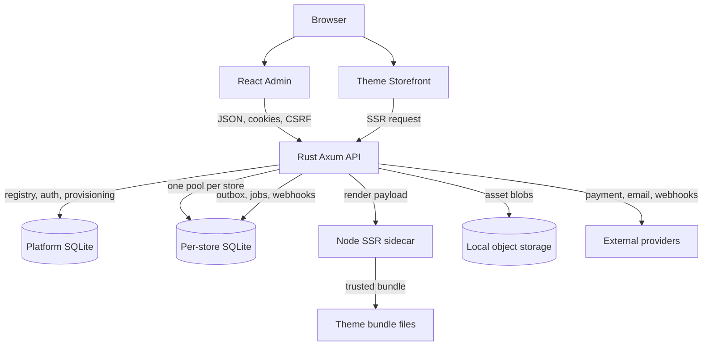

# Fastcart Container View

## Orientation

This container view shows how a browser request reaches the Rust API, the platform and per-store databases, the Node SSR sidecar and external providers. It is for engineers changing deployment topology, crate boundaries or the SSR runtime.

## Drift instrument

The container boundary is exercised by the cross-store isolation suite, the storefront SSR integration tests and the sidecar protocol tests. A dependency from `crates/kernel` or `crates/storefront` onto a provider crate is a boundary drift signal; review crate manifests when adding dependencies and run `cargo test --workspace`. The sidecar contract is covered by `node --test apps/theme-sidecar/test`.
