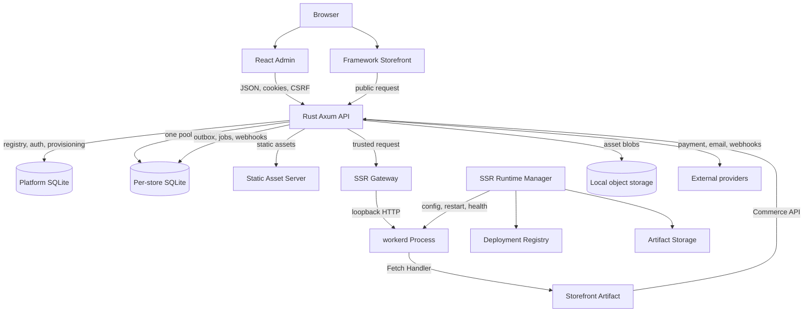

# Fastcart Container View

## Orientation

This container view shows the target universal SSR topology: how a browser
request reaches the Rust API, the platform and per-store databases, the SSR
gateway, the `workerd` runtime and external providers. It is for engineers
changing deployment topology, crate boundaries or the SSR runtime.

The universal runtime is specified by
[ADR 0007](../adr/0007-universal-ssr-runtime-with-workerd.md) and the phased
[Universal SSR Runtime](../architecture/universal-ssr-runtime.md) plan. The Node
sidecar and `runtime-v8` are legacy and are not part of this target.

## Boundaries

- `fastcart-serve` is the only public HTTP entry point. It resolves the store
  from the trusted hostname, opens the store database and owns commerce,
  authentication, admin and static asset serving.
- The SSR gateway strips client-supplied internal headers and injects a trusted
  store/deployment/request context. The Worker cannot choose a store.
- `workerd` executes framework-built Worker artifacts and calls the internal
  Commerce API. It never receives database access, admin credentials or payment
  secrets.
- `fastcart-ssr` owns the deployment registry, activation and rollback,
  previews, the response cache and static asset serving.
- `fastcart-ssr-workerd` owns the runtime manager, process supervisor, artifact
  validation and the loopback gateway. A workerd process crash must not take
  down the commerce API.
- Static assets under `/_fastcart/assets/` are served by Rust, not by workerd.

## Implementation status

The workerd execution layer, artifact pipeline, gateway, runtime manager and
deployment lifecycle are implemented in `crates/ssr-workerd` and `crates/ssr`.

[ADR 0008](../adr/0008-themes-as-deployment-artifacts.md) makes the storefront
artifact the only theme contract. `crates/storefront-runtime/runtime-v8` and
`runtime-bridge` are already removed; the Node sidecar, the remaining
`runtime-*` crates, the `storefront.runtime` switch and the secret-gated
`/internal/storefront` surface are being removed next. Until that lands, the
legacy path still exists in the workspace but is not part of this target view.

## Drift instrument

The target boundary is exercised by four suites: cross-store isolation, artifact
validation (manifest, digest, path traversal, missing entry), SSR gateway tests
(header filtering, trusted context, streaming, timeouts, multiple `Set-Cookie`)
and workerd framework fixtures (TanStack Start, Astro, generic Fetch handler).
A dependency from `crates/kernel` or `crates/storefront` onto workerd-specific
types is a boundary drift signal; keep workerd process management inside
`fastcart-ssr-workerd` and deployment lifecycle inside `fastcart-ssr`. The
legacy sidecar protocol tests are transitional and must be removed with the
legacy adapters.
