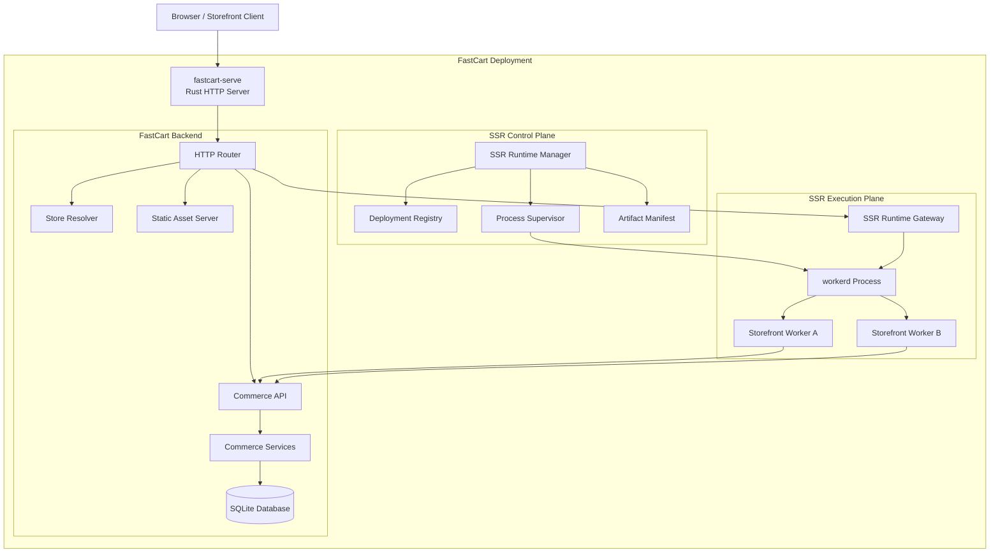
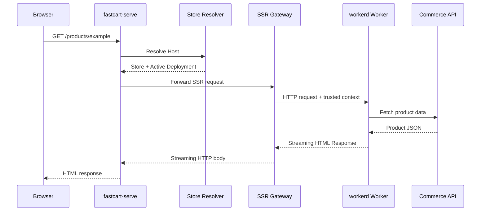
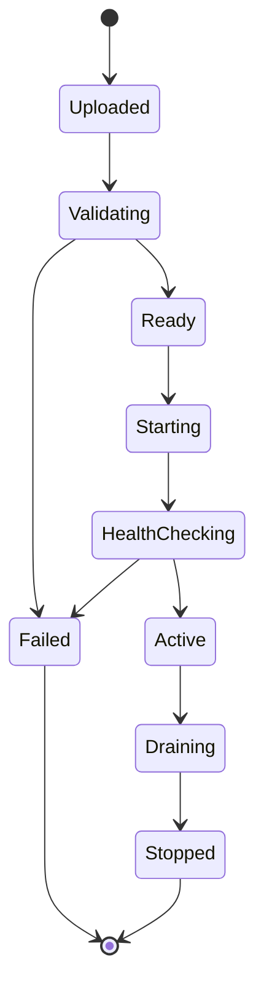
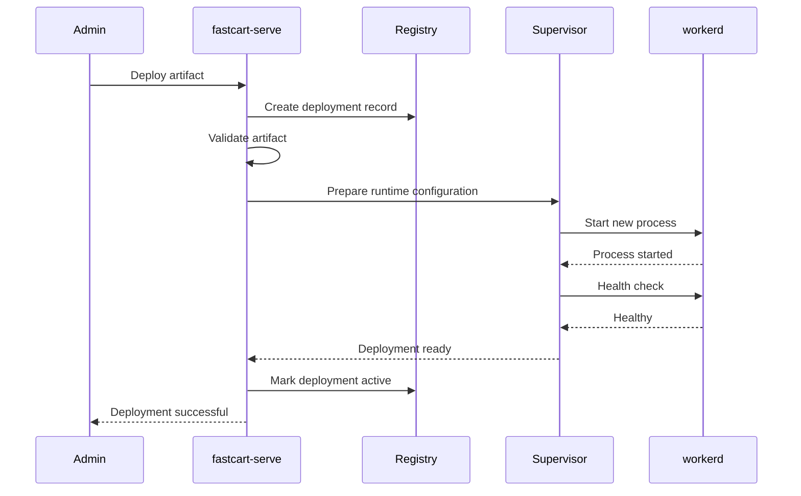
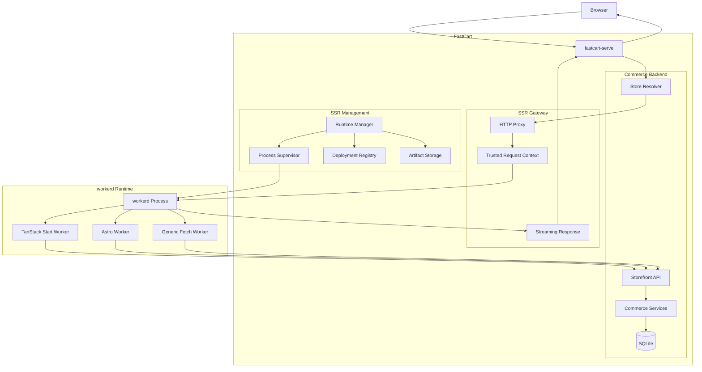

# FastCart Universal SSR Runtime

## Architecture Design & Implementation Plan

**Status:** Proposed Architecture  
**Runtime:** Cloudflare workerd  
**Backend:** Rust  
**Frontend Frameworks:** TanStack Start / Astro / SvelteKit / React Router / Extensible  
**Deployment Model:** Self-hosted, process-isolated SSR runtime  
**Primary Goal:** Provide a framework-agnostic, production-ready SSR execution environment for FastCart Storefront applications.

---

# Part I — Architecture Design

# 1. Overview

## 1.1 Background

FastCart is a self-hosted, Rust-based ecommerce platform. Its backend is responsible for:

- Store management and multi-tenancy.
- Product catalog and inventory.
- Shopping carts and checkout.
- Orders and payment integrations.
- Customer accounts and authentication.
- Admin APIs and storefront APIs.
- Database management.
- Static asset delivery.
- Storefront deployment and lifecycle management.

The Storefront needs to support modern frontend frameworks with server-side rendering (SSR), static generation, streaming, and client-side hydration.

Different frameworks have different runtime requirements:

| Framework | Runtime requirements | Typical deployment output |
|---|---|---|
| TanStack Start | Fetch API, Web APIs, SSR server entry | Worker-compatible server bundle |
| Astro | Adapter-provided server entry, Web APIs | Server bundle + static assets |
| SvelteKit | Platform adapter and Web APIs | Server bundle + static assets |
| React Router | Fetch-compatible request handler | Server bundle + static assets |
| Vite SSR | Custom SSR entry and module loading | Framework-specific server bundle |

Implementing a separate SSR runtime for every framework would introduce unnecessary complexity.

FastCart should therefore implement a universal execution layer that accepts standardized SSR artifacts.

## 1.2 Goals

The SSR Runtime should provide:

1. **Framework independence**
   - No dependency on React, Vue, Svelte, or a specific frontend framework.
   - Framework-specific behavior belongs in build adapters.
   - Runtime execution uses a standardized request/response contract.

2. **Standard Web APIs**
   - Fetch API.
   - Request / Response / Headers.
   - ReadableStream / WritableStream.
   - Web Crypto.
   - URL / URLSearchParams.
   - AbortController.
   - Timers and other supported Web APIs.

3. **Streaming SSR**
   - Support streaming HTML responses.
   - Preserve backpressure where possible.
   - Avoid buffering the entire rendered page in memory.

4. **Multiple rendering strategies**
   - Static rendering.
   - Dynamic SSR.
   - Hybrid rendering.
   - Incremental static regeneration as a future capability.

5. **Commerce integration**
   - Provide a framework-independent Storefront SDK.
   - Allow server-side rendering to access FastCart Commerce APIs.
   - Keep database access and sensitive backend credentials outside the JS runtime.

6. **Multi-store support**
   - Support multiple storefront deployments.
   - Isolate request-specific store context.
   - Allow different stores to use different frontend frameworks and bundle versions.

7. **Independent lifecycle**
   - Start and stop SSR processes independently.
   - Monitor health and resource consumption.
   - Support deployment replacement and rollback.

8. **Extensibility**
   - Support additional frontend frameworks.
   - Allow future alternative SSR execution backends.
   - Keep framework-specific code outside the Rust core.

## 1.3 Non-goals

The first implementation will not attempt to:

- Reimplement V8 or JavaScript execution.
- Reimplement the entire Cloudflare Workers platform.
- Provide a general-purpose untrusted JavaScript sandbox.
- Support every Cloudflare binding.
- Provide a complete Node.js runtime.
- Implement a distributed SSR scheduler.
- Implement a distributed cache.
- Support arbitrary user-installed native Node.js modules.
- Replace Vite, Astro, or framework build systems.
- Provide a general-purpose JavaScript package manager.

These boundaries are important to keep the first version manageable.

---

# 2. High-level Architecture

## 2.1 System topology

The recommended architecture separates the Rust application server from the JavaScript execution runtime.



The diagram represents logical responsibilities. In the initial deployment, the SSR Runtime Gateway and Runtime Manager can both be implemented inside the `fastcart-serve` process.

## 2.2 Process boundaries

The recommended initial deployment contains two primary processes.

| Process | Responsibility |
|---|---|
| `fastcart-serve` | Main HTTP server, commerce backend, database, static assets, SSR management |
| `workerd` | JavaScript execution, Web APIs, Worker execution, SSR |

The two processes communicate through private local HTTP connections.

The public HTTP entry point remains `fastcart-serve`.

This avoids exposing the workerd listener directly to the Internet.

### Why separate processes?

There are several advantages:

- A JS runtime crash does not need to terminate the Commerce API.
- Runtime versions can be upgraded independently.
- Memory and CPU limits can be applied independently.
- SSR workers can be restarted without restarting the database or backend.
- The backend does not need to embed V8.
- Alternative SSR execution backends can be introduced later.

## 2.3 Request flow

A typical storefront request follows this flow:



### Request processing responsibilities

**`fastcart-serve`:**

1. Receive the public request.
2. Resolve the requested hostname to a Store.
3. Resolve the active Storefront deployment.
4. Determine whether the request should be handled by static assets or SSR.
5. Attach trusted request context.
6. Forward the request to the corresponding SSR runtime.
7. Stream the response back to the client.

**`workerd`:**

1. Receive the forwarded request.
2. Execute the selected Worker handler.
3. Use the FastCart Storefront SDK to request Commerce data.
4. Render the page.
5. Return a standard Fetch `Response`.
6. Stream the body to the caller.

---

# 3. Core Architectural Principles

## 3.1 Framework-agnostic runtime

The runtime must not know about framework-specific concepts such as:

- React components.
- TanStack Router.
- Astro pages.
- Svelte components.
- Vue components.
- Framework-specific loaders.

It only understands a standard Worker entrypoint.

The contract is:

```typescript
export default {
  async fetch(
    request: Request,
    env: Env,
    ctx: ExecutionContext
  ): Promise<Response> {
    return new Response("Hello FastCart");
  },
};
```

This is the key abstraction.

If a framework can generate a compatible Worker entrypoint, it can run inside FastCart.

## 3.2 Build-time framework integration

Framework-specific logic belongs in the build pipeline.

For example:

```text
TanStack Start Project
        |
        v
TanStack Start Build
        |
        v
Cloudflare Vite Plugin
        |
        v
Worker-compatible SSR Bundle
        |
        v
FastCart Artifact Packaging
        |
        v
FastCart Deployment
```

Astro follows a similar flow:

```text
Astro Project
      |
      v
Astro Build
      |
      v
@astrojs/cloudflare
      |
      v
Worker-compatible SSR Bundle
      |
      v
FastCart Artifact Packaging
      |
      v
FastCart Deployment
```

FastCart should reuse official framework adapters wherever practical.

It should not build and maintain independent SSR adapters for every framework.

However, Cloudflare adapters may depend on platform-specific bindings. FastCart must either implement compatible bindings or document unsupported capabilities.

## 3.3 Standardized artifact contract

All framework builds should produce a standardized FastCart SSR Artifact.

The artifact contract is independent of the framework.

```text
Framework Build Output
        |
        v
Framework Adapter
        |
        v
FastCart Artifact Packager
        |
        v
FastCart SSR Artifact
        |
        v
workerd
```

The artifact is the boundary between frontend development and the FastCart runtime.

## 3.4 Runtime abstraction

The Rust implementation should depend on an abstract SSR execution backend.

The initial implementation is workerd.

Conceptually:

```rust
#[async_trait]
pub trait SsrExecutionBackend {
    async fn start(
        &self,
        config: RuntimeConfig,
    ) -> Result<RuntimeHandle>;

    async fn stop(
        &self,
        handle: RuntimeHandle,
    ) -> Result<()>;

    async fn health_check(
        &self,
        handle: &RuntimeHandle,
    ) -> Result<RuntimeHealth>;

    async fn deploy(
        &self,
        deployment: Deployment,
    ) -> Result<DeploymentHandle>;
}
```

This abstraction is not intended to introduce unnecessary complexity in the first release.

It exists to keep workerd-specific process management out of the Commerce domain.

Future backends might include:

- OpenWorkers.
- Deno-based runtime.
- Node.js.
- A custom V8 runtime.

---

# 4. workerd Runtime Design

## 4.1 Why workerd?

`workerd` is the open-source JavaScript/Wasm server runtime used by Cloudflare Workers.

It is suitable for FastCart because it provides:

- V8-based JavaScript execution.
- Web Platform APIs.
- Fetch API.
- Request and Response.
- Streams.
- Web Crypto.
- Worker execution model.
- Service bindings.
- Configurable compatibility dates.
- A standardized deployment model.

Most importantly, it is designed to execute server-side applications rather than only provide a JavaScript command-line environment.

FastCart can therefore use workerd as a standardized SSR execution backend.

## 4.2 workerd configuration

workerd uses Cap'n Proto text configuration.

A simplified configuration looks like this:

```capnp
using Workerd = import "/workerd/workerd.capnp";

const config :Workerd.Config = (
  services = [
    (
      name = "storefront",
      worker = .storefrontWorker
    ),
  ],

  sockets = [
    (
      name = "http",
      address = "127.0.0.1:8081",
      http = (),
      service = "storefront"
    ),
  ],
);

const storefrontWorker :Workerd.Worker = (
  serviceWorkerScript = embed "worker.js",
  compatibilityDate = "2026-11-01",
);
```

This is an illustrative configuration. The actual generated configuration must be validated against the exact workerd version selected by FastCart.

## 4.3 Runtime process model

The first version should use a simple process model:

```text
fastcart-serve
    |
    +-- SSR Runtime Manager
            |
            +-- workerd Process
                    |
                    +-- Worker Service A
                    +-- Worker Service B
                    +-- Worker Service C
```

A workerd process can host multiple Worker services.

This allows multiple Storefront deployments to share one process when they belong to the same trust group.

However, process sharing must not be confused with strong tenant isolation.

### Recommended deployment grouping

| Workload | Runtime strategy |
|---|---|
| FastCart official storefront templates | Shared workerd process |
| Trusted merchant storefront bundles | Shared process or grouped process |
| Third-party reviewed extensions | Separate process group |
| Arbitrary merchant-uploaded JavaScript | Separate OS-level sandbox |
| Potentially malicious code | VM/container with additional isolation |

A single workerd process per Store is unnecessary for the initial implementation.

A single workerd process for all untrusted merchants is also not recommended.

## 4.4 Runtime version management

FastCart should pin a specific workerd version.

Example:

```toml
[ssr]
runtime = "workerd"
version = "2026.10.0"
compatibility_date = "2026-11-01"
```

The actual version string must match the selected workerd release.

Do not automatically upgrade the runtime every time FastCart starts.

A runtime upgrade should be an explicit operation:

1. Download or locate the new runtime binary.
2. Verify its checksum.
3. Validate the binary version.
4. Run compatibility tests.
5. Start a new runtime process.
6. Execute health checks.
7. Switch traffic.
8. Drain the previous process.

## 4.5 Compatibility date

Every Worker should have an explicit compatibility date.

This date determines the Worker API behavior expected by the application.

FastCart should record the compatibility date in the artifact manifest.

Do not silently change the compatibility date during runtime upgrades.

A runtime upgrade and a compatibility-date upgrade are separate operations.

## 4.6 Node.js compatibility

Some frameworks and packages rely on Node.js built-in modules.

workerd provides a Node.js compatibility layer, but it should not be treated as a complete Node.js server runtime.

FastCart should:

- Support the compatibility mode required by the chosen framework.
- Pin compatibility settings.
- Validate dependencies during build.
- Reject unsupported native Node.js dependencies.
- Avoid promising unrestricted Node.js compatibility.

The first supported frontend stack should be tested explicitly with the actual generated bundle.

---

# 5. SSR Runtime Gateway

## 5.1 Responsibility

The SSR Runtime Gateway is the bridge between the Rust HTTP server and workerd.

It should provide:

- Request routing.
- Deployment lookup.
- Runtime endpoint selection.
- Trusted context injection.
- Request forwarding.
- Response streaming.
- Timeout handling.
- Error mapping.
- Basic runtime metrics.

It should not contain framework-specific rendering logic.

## 5.2 Internal HTTP protocol

The first implementation should use HTTP over loopback TCP.

Example:

```text
fastcart-serve
    |
    | HTTP
    v
127.0.0.1:8081
    |
    v
workerd
```

Unix Domain Sockets can be considered later, after verifying support in the chosen workerd build and configuration.

Do not make UDS a hard dependency.

### Why HTTP?

HTTP provides a simple and portable interface:

- Standard request and response semantics.
- Natural streaming support.
- Easy local debugging.
- Easy integration with Rust HTTP libraries.
- No custom IPC protocol required.

The initial implementation does not need gRPC or a custom binary protocol.

## 5.3 Request context

FastCart needs to pass trusted Store context to the SSR worker.

Example:

```json
{
  "store_id": "store_123",
  "deployment_id": "deploy_456",
  "request_id": "req_789",
  "locale": "en-US",
  "currency": "USD",
  "market_id": "market_001"
}
```

This context must be generated by `fastcart-serve`.

It must not be accepted directly from arbitrary client headers.

### Recommended approach

1. `fastcart-serve` removes any client-supplied internal context headers.
2. It resolves the Store from the trusted hostname mapping.
3. It constructs a new internal context.
4. It forwards the request with internal context headers.
5. workerd passes the context to the framework handler.

Example headers:

```http
X-FastCart-Store-Id: store_123
X-FastCart-Deployment-Id: deploy_456
X-FastCart-Request-Id: req_789
X-FastCart-Internal-Token: <short-lived-secret>
```

The internal token is only an authentication mechanism between the local processes.

It should not be exposed to browser responses.

For stronger isolation, the token can be rotated and scoped to the runtime group.

The Store ID must be validated against the deployment configuration.

## 5.4 Header security

The gateway must prevent header spoofing.

The following headers must be controlled by the Rust server:

- `X-FastCart-Store-Id`
- `X-FastCart-Deployment-Id`
- `X-FastCart-Request-Id`
- `X-FastCart-Internal-Token`

The SSR worker must not be allowed to choose an arbitrary Store ID and thereby gain access to another Store's data.

## 5.5 Streaming

Streaming is a first-class requirement.

The response path should be:

```text
Framework ReadableStream
        |
        v
workerd HTTP Response
        |
        v
Rust HTTP Body Stream
        |
        v
Client
```

Avoid:

```text
Framework ReadableStream
        |
        v
Collect entire response into Vec<u8>
        |
        v
Return response
```

The latter eliminates most benefits of streaming SSR and can cause high memory usage.

Rust HTTP clients and servers should be configured to forward body streams without eagerly collecting them.

## 5.6 Timeouts

The gateway should distinguish:

| Timeout | Meaning |
|---|---|
| Connection timeout | Time allowed to connect to workerd |
| Header timeout | Time allowed to receive response headers |
| Total request timeout | Maximum SSR request duration |
| Idle body timeout | Maximum interval without response body progress |

Defaults should be configurable.

Do not impose a very short fixed timeout on streaming responses.

## 5.7 Error handling

The gateway should distinguish runtime failures from application responses.

Suggested internal error categories:

```rust
pub enum SsrError {
    RuntimeUnavailable,
    RuntimeTimeout,
    WorkerException,
    InvalidArtifact,
    DeploymentNotFound,
    InternalAuthenticationFailed,
    ResponseProtocolError,
}
```

Suggested public behavior:

| Internal condition | Public behavior |
|---|---|
| Worker returns 404 | Forward 404 |
| Worker returns 500 | Forward or normalize 500 |
| Runtime unavailable | 503 |
| Runtime timeout | 504 |
| Invalid deployment | 500 and operational alert |
| Worker crashes | 503 or 500 depending on request state |

Do not convert every worker exception into a 404.

---

# 6. FastCart SSR Artifact Specification

## 6.1 Design goals

The artifact is the standardized deployment unit.

It must:

- Be independent of frontend framework.
- Contain the Worker server bundle.
- Reference client-side assets.
- Include runtime compatibility metadata.
- Include framework metadata.
- Be versionable.
- Be verifiable.
- Be deployable without running the frontend build system on the production server.

## 6.2 Artifact directory structure

Recommended structure:

```text
storefront-artifact/
├── fastcart-ssr.json
├── worker/
│   ├── index.js
│   └── chunks/
│       ├── chunk-001.js
│       └── chunk-002.js
├── client/
│   ├── assets/
│   │   ├── app-abc123.js
│   │   └── app-def456.css
│   ├── images/
│   └── fonts/
└── static/
    ├── favicon.ico
    ├── robots.txt
    └── sitemap.xml
```

This is a logical layout. The packager may produce a compressed archive for storage and deployment.

## 6.3 Manifest

Example:

```json
{
  "schema_version": "1",
  "artifact_id": "artifact_01",
  "framework": {
    "name": "tanstack-start",
    "version": "1.x"
  },
  "runtime": {
    "engine": "workerd",
    "compatibility_date": "2026-11-01",
    "compatibility_flags": [],
    "required_capabilities": [
      "fetch",
      "streams",
      "web-crypto"
    ]
  },
  "entry": {
    "type": "worker",
    "path": "worker/index.js",
    "export": "default"
  },
  "assets": {
    "directory": "client",
    "base_path": "/_fastcart/assets/"
  },
  "rendering": {
    "mode": "hybrid",
    "streaming": true
  },
  "build": {
    "build_id": "build_123",
    "created_at": "2026-11-01T10:00:00Z"
  }
}
```

This schema is illustrative and should be versioned from the first release.

## 6.4 Required fields

| Field | Purpose |
|---|---|
| `schema_version` | Manifest schema compatibility |
| `artifact_id` | Unique artifact identity |
| `framework.name` | Framework identification |
| `framework.version` | Framework version |
| `runtime.engine` | Execution backend |
| `runtime.compatibility_date` | Worker compatibility date |
| `entry.path` | SSR entrypoint |
| `assets.directory` | Client assets location |
| `rendering.mode` | Rendering strategy |
| `build.build_id` | Build identity |

## 6.5 Optional fields

Future fields may include:

- Required Worker bindings.
- Node.js compatibility settings.
- Maximum memory estimate.
- Asset integrity hashes.
- Build provenance.
- Source maps.
- Runtime feature requirements.
- Framework adapter version.
- Static route metadata.
- Cache policy defaults.
- Compression metadata.

## 6.6 Artifact validation

Before deployment, FastCart must validate:

1. Manifest exists.
2. Manifest schema is supported.
3. Entry file exists.
4. All declared asset directories exist.
5. Artifact paths do not escape the artifact root.
6. Runtime compatibility settings are valid.
7. Required capabilities are supported.
8. Artifact size is within configured limits.
9. Artifact integrity checks pass.
10. The bundle can start and respond to a health request.

Artifact paths must be normalized to prevent path traversal.

## 6.7 Artifact integrity

Every artifact should have a cryptographic digest.

Recommended approach:

- SHA-256 for the complete artifact archive.
- SHA-256 hashes for individual files when needed.
- Store the digest in the deployment record.
- Verify before extraction.
- Make extracted deployment directories immutable to the runtime process where practical.

---

# 7. Framework Adapter Architecture

## 7.1 Adapter responsibilities

A framework adapter is responsible for converting framework-specific build output into a FastCart-compatible artifact.

It should not implement a new SSR engine.

The adapter should:

1. Configure the framework for workerd.
2. Invoke the framework's build process.
3. Locate the Worker entrypoint.
4. Locate client-side assets.
5. Generate or normalize the manifest.
6. Validate output structure.
7. Package the artifact.

## 7.2 Adapter interface

A conceptual TypeScript interface:

```typescript
export interface FastCartFrameworkAdapter {
  readonly name: string;
  readonly version: string;

  detect(projectDir: string): Promise<boolean>;

  build(
    options: FrameworkBuildOptions
  ): Promise<FrameworkBuildResult>;

  package(
    result: FrameworkBuildResult
  ): Promise<FastCartArtifact>;
}
```

This interface belongs to the build tooling, not the Rust runtime.

## 7.3 TanStack Start adapter

TanStack Start should be the first supported framework.

Reasons:

- It supports SSR.
- It supports streaming.
- It uses Vite.
- It has an official Cloudflare integration path.
- It provides server entrypoints compatible with the Worker model.

Recommended integration:

```text
TanStack Start
      |
      v
Vite
      |
      v
@cloudflare/vite-plugin
      |
      v
TanStack Start server entry
      |
      v
Worker Bundle
      |
      v
FastCart Packager
```

FastCart should provide a starter template and a small compatibility package.

The first release should use the official Cloudflare Vite integration instead of maintaining a fork.

### Required verification

The following must be tested:

- SSR rendering.
- Route loaders.
- Server functions.
- Request context.
- Cookie handling.
- Redirects.
- Error boundaries.
- Streaming.
- Static asset paths.
- Build output.
- Server-only modules.
- Required Worker bindings.

Cloudflare-specific imports and bindings must be tested against FastCart's supported runtime capabilities.

## 7.4 Astro adapter

Astro should be the second framework integration.

Recommended approach:

```text
Astro
  |
  v
@astrojs/cloudflare
  |
  v
Worker-compatible SSR output
  |
  v
FastCart Packager
```

Astro's hybrid rendering and prerendering capabilities are particularly useful for ecommerce storefronts.

The adapter should normalize:

- Server entry.
- Static assets.
- Prerendered pages.
- Runtime rendering metadata.
- Asset base paths.

## 7.5 Future framework support

Potential future integrations:

| Framework | Priority | Notes |
|---|---:|---|
| TanStack Start | P0 | First integration |
| Astro | P1 | Strong static/hybrid support |
| SvelteKit | P2 | Use official Cloudflare adapter |
| React Router | P2 | Fetch-compatible server handler |
| Vike | P3 | Evaluate Worker adapter |
| Custom Fetch Handler | P0 | Generic fallback |

The generic Fetch Handler should be the actual runtime contract.

Framework adapters are only build-time integrations.

---

# 8. FastCart Storefront SDK

## 8.1 Motivation

A storefront should not directly know the internal structure of the Rust backend.

It should consume a stable Commerce API abstraction.

The SDK must be independent of the framework.

## 8.2 Package structure

```text
packages/
└── storefront-sdk/
    ├── src/
    │   ├── client.ts
    │   ├── context.ts
    │   ├── products.ts
    │   ├── collections.ts
    │   ├── categories.ts
    │   ├── carts.ts
    │   ├── checkout.ts
    │   ├── customers.ts
    │   ├── orders.ts
    │   ├── markets.ts
    │   ├── errors.ts
    │   └── index.ts
    └── package.json
```

## 8.3 Client creation

Example:

```typescript
import { createStorefrontClient } from "@fastcart/storefront-sdk";

const client = createStorefrontClient({
  baseUrl: env.FASTCART_API_URL,
  storeId: context.storeId,
});
```

The client should use standard Fetch.

It should not require a particular frontend framework.

## 8.4 API examples

```typescript
const product = await client.products.retrieve("product_123");

const products = await client.products.list({
  limit: 20,
  category: "clothing",
});

const cart = await client.carts.retrieve(cartId);

const updatedCart = await client.carts.addItem(cartId, {
  variantId: "variant_123",
  quantity: 2,
});
```

## 8.5 Server-side and browser-side clients

There are two distinct execution environments.

### Server-side client

The SSR worker can use an internal Commerce API endpoint.

It should receive:

- Store context.
- Request correlation ID.
- Internal API authentication.
- Request-scoped locale and currency.

The internal authentication token must never be serialized into the HTML or browser bundle.

### Browser-side client

The browser uses the public Storefront API.

It must not receive internal credentials.

The SDK should expose separate entrypoints or explicit constructors for server and browser usage.

Example:

```typescript
const serverClient = createServerStorefrontClient(...);

const browserClient = createBrowserStorefrontClient(...);
```

The package should avoid accidentally importing server-only modules into browser bundles.

## 8.6 Request-scoped context

The SSR worker must not store mutable Store-specific request data in module-level globals.

Incorrect:

```typescript
let currentStoreId: string;

export default {
  async fetch(request: Request) {
    currentStoreId = request.headers.get(
      "X-FastCart-Store-Id"
    )!;

    return renderPage();
  },
};
```

Concurrent requests could overwrite each other's state.

Correct:

```typescript
export default {
  async fetch(request: Request, env: Env) {
    const context = createRequestContext(request, env);

    return renderPage(request, context);
  },
};
```

Every request receives its own context object.

---

# 9. Commerce API Integration

## 9.1 Initial integration model

The first version should use internal HTTP APIs.

```text
workerd
   |
   | HTTP Fetch
   v
fastcart-serve internal API
   |
   v
Commerce Services
   |
   v
SQLite
```

Do not expose SQLite directly to the SSR runtime.

Do not create a custom Rust-to-JavaScript native binding in the first version.

## 9.2 Internal API namespace

Example:

```text
/internal/ssr/v1/stores/{store_id}/products
/internal/ssr/v1/stores/{store_id}/collections
/internal/ssr/v1/stores/{store_id}/carts
/internal/ssr/v1/stores/{store_id}/markets
```

The exact routes should reuse existing Commerce service interfaces wherever possible.

The internal API is an execution boundary, not a reason to duplicate Commerce business logic.

## 9.3 Authentication

Recommended:

- A dedicated internal service credential.
- Short-lived or rotatable tokens.
- Strict loopback binding.
- Request-level authentication.
- Store/deployment authorization.
- No internal credential exposure to browser responses.

The server should validate:

```text
authenticated runtime
        +
deployment identity
        +
trusted store identity
        |
        v
authorized Commerce operation
```

## 9.4 Request propagation

Propagate:

- Request ID.
- Trace ID.
- Store ID.
- Deployment ID.
- Locale.
- Currency.
- Market.
- User/session context where authorized.

Do not blindly forward every incoming browser header to internal APIs.

Define an explicit header allowlist.

## 9.5 Cookie and session handling

SSR should support normal browser cookies.

The runtime must preserve:

- `Cookie` request headers.
- `Set-Cookie` response headers.
- Redirect responses.
- SameSite behavior.
- Secure cookie attributes.
- Multiple `Set-Cookie` headers.

The Rust proxy must not merge multiple `Set-Cookie` values incorrectly.

Authentication and customer session validation should remain owned by the Commerce backend.

---

# 10. Static Assets and Rendering Strategies

## 10.1 Rendering modes

FastCart should support three rendering modes.

| Mode | Description | Example |
|---|---|---|
| Static | HTML generated at build time | About page |
| SSR | HTML generated per request | Personalized account page |
| Hybrid | Mix of static and dynamic routes | Ecommerce storefront |

## 10.2 Static asset serving

The recommended design is to let `fastcart-serve` serve static assets directly.

Example:

```text
https://store.example.com/
    |
    v
fastcart-serve
    |
    +-- /_fastcart/assets/*
    |       |
    |       v
    |   Static asset server
    |
    +-- /products/*
    |       |
    |       v
    |   SSR Runtime
    |
    +-- /cart
            |
            v
        SSR Runtime
```

Advantages:

- Static assets do not consume workerd execution resources.
- Rust can use efficient static file serving.
- CDN integration is straightforward.
- Cache headers can be managed centrally.
- SSR runtime remains focused on rendering.

## 10.3 Asset URL strategy

Use a stable internal asset prefix:

```text
/_fastcart/assets/
```

The actual asset location is deployment-specific.

The artifact manifest declares the asset directory and public base path.

Assets should be immutable and content-hashed.

Example:

```text
/_fastcart/assets/app.8f21a1.js
/_fastcart/assets/styles.91a4c3.css
```

Recommended cache policy:

```http
Cache-Control: public, max-age=31536000, immutable
```

For HTML, use a separate cache policy.

## 10.4 Static route prerendering

Frameworks may generate static HTML at build time.

FastCart should package these outputs as static artifacts.

The initial implementation can support static output generated by the framework's build system.

It does not need to implement a new prerendering engine.

## 10.5 Hybrid rendering

The runtime should use framework-defined route behavior.

FastCart does not need to understand whether a specific route is static or dynamic if the framework's build output already handles that distinction.

FastCart only needs to know:

- Which paths map to static assets.
- Which paths should reach SSR.
- Whether an artifact contains prerendered routes.
- How to serve fallback routes.

## 10.6 Cache strategy

Do not initially build a complex distributed cache.

Start with:

1. Immutable static assets.
2. Framework-managed SSR caching where supported.
3. HTTP cache headers.
4. Optional local response cache for explicitly cacheable routes.

Never cache personalized HTML by default.

Cache keys must account for relevant dimensions, such as:

- Store.
- Locale.
- Currency.
- Market.
- Authentication state.
- Query parameters.
- Relevant cookies.

---

# 11. Multi-tenancy and Isolation

## 11.1 Tenant model

FastCart uses a multi-store architecture.

Each Store may have:

- Its own domain.
- Its own storefront bundle.
- Its own theme.
- Its own assets.
- Its own configuration.
- Its own runtime compatibility requirements.

The runtime must therefore support multiple deployments.

## 11.2 Deployment registry

The Rust backend should maintain a deployment registry.

Conceptual model:

```text
Store
  |
  +-- StorefrontDeployment
          |
          +-- Artifact
          +-- RuntimeGroup
          +-- Version
          +-- Status
          +-- Active Flag
```

## 11.3 Runtime grouping

The initial runtime grouping strategy:

```text
Runtime Group: trusted-default
    |
    +-- Store A deployment
    +-- Store B deployment
    +-- Store C deployment

Runtime Group: isolated-tenant-001
    |
    +-- Store D deployment
```

Grouping is based on trust and operational constraints.

Do not automatically create one process per Store.

## 11.4 Isolation levels

Three isolation levels should be defined.

| Level | Description | Suitable for |
|---|---|---|
| Shared Worker process | Multiple Worker services in one workerd process | Trusted code |
| Dedicated workerd process | Separate process per trust group | Reviewed third-party code |
| OS sandbox | Container or VM boundary | Arbitrary or untrusted code |

A workerd isolate is not an OS security boundary.

The workerd project explicitly warns that it is not a hardened sandbox and recommends additional isolation such as a VM for potentially malicious code.

Therefore:

- Do not claim that V8 isolates alone safely contain arbitrary merchant JavaScript.
- Do not allow arbitrary native modules.
- Do not expose host filesystem access.
- Do not grant unrestricted outbound network access.
- Do not run untrusted build scripts directly on the FastCart host.

## 11.5 Cross-store isolation

The most important application-level isolation rule is:

**Store context must be resolved by the trusted Rust server, not chosen by storefront JavaScript.**

Commerce APIs must independently verify the Store context.

A compromised or misconfigured Worker must not be able to query another Store by changing an ID in an HTTP request.

## 11.6 Runtime resource limits

The process supervisor should support configurable limits:

- Maximum process memory.
- Maximum CPU consumption where the OS permits enforcement.
- Maximum concurrent requests.
- Maximum request duration.
- Maximum artifact size.
- Maximum number of deployments per runtime group.
- Maximum outbound connections.

Some limits require OS-level controls rather than workerd configuration.

---

# 12. Deployment Lifecycle

## 12.1 Deployment states

Suggested state machine:



A deployment should not become active until the runtime has passed health checks.

## 12.2 Deployment flow



## 12.3 Versioned deployment

Each deployment should have an immutable version.

Example:

```text
store_123/
    deployments/
        deploy_001/
        deploy_002/
        deploy_003/
    current -> deploy_003
```

The actual implementation should use a deployment registry rather than relying solely on filesystem symlinks.

## 12.4 Rolling replacement

The initial implementation should use process replacement rather than complex hot reloading.

Recommended sequence:

1. Build a new runtime configuration.
2. Start the new workerd process.
3. Run a health check.
4. Validate the target deployment.
5. Switch routing to the new process or Worker service.
6. Stop accepting new requests on the old deployment.
7. Drain in-flight requests.
8. Stop the old process.
9. Keep the previous artifact available for rollback.

## 12.5 Rollback

Rollback should be simple:

- Retain the previous deployment.
- Change the active deployment pointer.
- Route new requests to the previous healthy deployment.
- Keep the failed deployment for diagnostics.
- Record the rollback event.

Do not delete the previous artifact immediately after a successful deployment.

## 12.6 Runtime restart

If workerd crashes:

1. Detect process exit.
2. Mark affected runtime group unhealthy.
3. Stop routing new requests to it.
4. Restart with bounded backoff.
5. Run health checks.
6. Restore traffic when healthy.
7. Record the failure.

Repeated crashes should trigger a circuit-breaker state rather than an infinite rapid restart loop.

---

# 13. SSR Runtime Management

## 13.1 Responsibility

The Runtime Manager owns the lifecycle of workerd.

It should manage:

- Runtime binary selection.
- Runtime process startup.
- Configuration generation.
- Process supervision.
- Health checks.
- Shutdown.
- Restart.
- Deployment activation.
- Runtime group management.

## 13.2 Rust interface

Suggested interface:

```rust
#[async_trait]
pub trait RuntimeManager: Send + Sync {
    async fn initialize(&self) -> Result<()>;

    async fn start_group(
        &self,
        group: RuntimeGroupId,
    ) -> Result<RuntimeHandle>;

    async fn stop_group(
        &self,
        group: RuntimeGroupId,
    ) -> Result<()>;

    async fn restart_group(
        &self,
        group: RuntimeGroupId,
    ) -> Result<RuntimeHandle>;

    async fn get_health(
        &self,
        group: RuntimeGroupId,
    ) -> Result<RuntimeHealth>;

    async fn deploy(
        &self,
        deployment: DeploymentId,
    ) -> Result<DeploymentResult>;
}
```

## 13.3 Configuration generation

The Runtime Manager generates workerd configuration from:

- Runtime version.
- Runtime group.
- Deployment registry.
- Artifact manifest.
- Worker entrypoint.
- Internal API bindings.
- Listening address.
- Compatibility settings.

Generated configurations should be stored in a dedicated runtime directory.

Example:

```text
data/
└── ssr/
    ├── runtime/
    │   ├── workerd/
    │   │   └── <version>/
    │   └── groups/
    │       └── trusted-default/
    │           ├── config.capnp
    │           ├── logs/
    │           └── state/
    ├── artifacts/
    └── deployments/
```

The exact workerd configuration must be generated using supported workerd syntax and validated against the pinned binary.

## 13.4 Configuration updates

Do not assume a running workerd process can dynamically load arbitrary new Worker services without a supported reload mechanism.

For the initial implementation, regenerate configuration and use process replacement when the deployment topology changes.

## 13.5 Runtime health

Health information should include:

```rust
pub struct RuntimeHealth {
    pub status: RuntimeStatus,
    pub process_id: Option<u32>,
    pub uptime_seconds: u64,
    pub memory_bytes: Option<u64>,
    pub last_health_check: DateTime<Utc>,
    pub restart_count: u32,
}
```

Additional metrics can be added later.

---

# 14. Security Architecture

## 14.1 Security boundaries

```text
Internet
   |
   v
fastcart-serve
   |
   +-- Commerce Services
   |       |
   |       v
   |     SQLite
   |
   +-- SSR Gateway
           |
           v
        workerd
           |
           +-- Storefront Bundle
           |
           +-- Internal Commerce API
```

The SSR runtime must not directly access the database.

## 14.2 Filesystem access

The runtime should only be able to read:

- Its Worker bundle.
- Required static runtime assets.
- Explicitly configured temporary files if needed.

It should not be able to read:

- FastCart database files.
- Admin configuration files.
- Payment provider secrets.
- Host user directories.
- Other Store deployment directories unless explicitly needed by the runtime architecture.

## 14.3 Network access

The first version should use a restrictive network model.

The Worker should have access to:

- The FastCart internal Commerce API.
- Explicitly configured external services when required.

It should not automatically have unrestricted access to arbitrary internal networks.

Outbound access should be configurable by runtime group.

## 14.4 Secrets

Do not inject all FastCart environment variables into workerd.

Only inject the minimum runtime configuration required.

In particular, do not expose:

- Database credentials.
- Payment provider secret keys.
- Admin API keys.
- JWT signing keys.
- Internal master credentials.

The Worker should use authorized Commerce APIs instead of receiving raw backend secrets.

## 14.5 Build-time security

Build scripts can execute arbitrary code through package lifecycle hooks.

Therefore, for untrusted storefront projects:

- Build in an isolated environment.
- Do not expose production credentials to builds.
- Restrict filesystem access.
- Restrict network access where practical.
- Pin dependencies.
- Preserve build provenance.

The workerd execution boundary does not automatically secure the build pipeline.

## 14.6 Operational security

Recommended:

- Bind workerd to loopback only.
- Protect internal HTTP requests.
- Restrict access to runtime directories.
- Validate uploaded artifacts.
- Avoid exposing runtime configuration publicly.
- Sanitize logs.
- Avoid logging authentication cookies or tokens.

---

# 15. Observability

## 15.1 Logging

Use structured logs.

Suggested fields:

```json
{
  "timestamp": "2026-11-01T10:00:00Z",
  "level": "info",
  "component": "ssr",
  "request_id": "req_123",
  "store_id": "store_123",
  "deployment_id": "deploy_123",
  "runtime_group": "trusted-default",
  "duration_ms": 42,
  "status_code": 200
}
```

## 15.2 Metrics

Initial metrics:

| Metric | Description |
|---|---|
| `fastcart_ssr_requests_total` | Total SSR requests |
| `fastcart_ssr_request_duration_seconds` | SSR request latency |
| `fastcart_ssr_errors_total` | SSR errors |
| `fastcart_ssr_runtime_restarts_total` | Runtime restarts |
| `fastcart_ssr_runtime_memory_bytes` | Runtime memory |
| `fastcart_ssr_active_deployments` | Active deployments |
| `fastcart_ssr_runtime_health` | Runtime health state |

## 15.3 Tracing

Propagate request IDs and trace IDs across:

```text
Browser
  -> fastcart-serve
  -> SSR Gateway
  -> workerd
  -> Commerce API
  -> Database
```

The first version can use request correlation IDs.

Full distributed tracing can be added later.

## 15.4 Error diagnostics

For Worker errors, capture:

- Store ID.
- Deployment ID.
- Runtime group.
- Request ID.
- Error class.
- Error message.
- Stack trace where available.
- Runtime version.

Never expose detailed stack traces to public storefront visitors.

---

# 16. Data Model

The SSR management layer needs persistent deployment metadata.

Suggested tables:

## 16.1 `storefront_deployments`

| Column | Type | Description |
|---|---|---|
| id | TEXT | Deployment ID |
| store_id | TEXT | Store ID |
| artifact_id | TEXT | Artifact ID |
| runtime_group_id | TEXT | Runtime group |
| framework | TEXT | Framework name |
| framework_version | TEXT | Framework version |
| runtime_version | TEXT | workerd version |
| compatibility_date | TEXT | Worker compatibility date |
| status | TEXT | Deployment status |
| created_at | TEXT | Creation time |
| activated_at | TEXT | Activation time |
| deactivated_at | TEXT | Deactivation time |

## 16.2 `storefront_artifacts`

| Column | Type | Description |
|---|---|---|
| id | TEXT | Artifact ID |
| store_id | TEXT | Store ID |
| digest | TEXT | SHA-256 digest |
| manifest_json | TEXT | Manifest |
| storage_path | TEXT | Artifact path |
| size_bytes | INTEGER | Artifact size |
| created_at | TEXT | Creation time |

## 16.3 `ssr_runtime_groups`

| Column | Type | Description |
|---|---|---|
| id | TEXT | Runtime group ID |
| name | TEXT | Runtime group name |
| runtime_version | TEXT | workerd version |
| isolation_level | TEXT | Isolation policy |
| listen_address | TEXT | Internal listener |
| status | TEXT | Runtime status |
| created_at | TEXT | Creation time |
| updated_at | TEXT | Last update |

## 16.4 `storefront_active_deployments`

This can be represented by an active deployment reference on the Store record or a separate mapping table.

The invariant must be:

**At most one active production deployment per Storefront hostname at a time.**

The activation operation should be transactional from the control-plane perspective.

---

# 17. Repository Architecture

The recommended structure is:

```text
fastcart/
├── apps/
│   ├── fastcart-server/
│   └── storefront/
│       ├── tanstack/
│       └── astro/
│
├── crates/
│   ├── fastcart-core/
│   ├── fastcart-commerce/
│   ├── fastcart-api/
│   ├── fastcart-server/
│   │
│   └── fastcart-ssr/
│       ├── src/
│       │   ├── lib.rs
│       │   ├── error.rs
│       │   ├── config.rs
│       │   │
│       │   ├── artifact/
│       │   │   ├── mod.rs
│       │   │   ├── manifest.rs
│       │   │   ├── validator.rs
│       │   │   ├── digest.rs
│       │   │   └── storage.rs
│       │   │
│       │   ├── deployment/
│       │   │   ├── mod.rs
│       │   │   ├── model.rs
│       │   │   ├── registry.rs
│       │   │   ├── lifecycle.rs
│       │   │   └── rollback.rs
│       │   │
│       │   ├── runtime/
│       │   │   ├── mod.rs
│       │   │   ├── backend.rs
│       │   │   ├── manager.rs
│       │   │   ├── supervisor.rs
│       │   │   ├── process.rs
│       │   │   ├── config_generator.rs
│       │   │   └── health.rs
│       │   │
│       │   ├── gateway/
│       │   │   ├── mod.rs
│       │   │   ├── router.rs
│       │   │   ├── proxy.rs
│       │   │   ├── context.rs
│       │   │   ├── headers.rs
│       │   │   └── streaming.rs
│       │   │
│       │   ├── security/
│       │   │   ├── mod.rs
│       │   │   ├── authentication.rs
│       │   │   ├── authorization.rs
│       │   │   └── policy.rs
│       │   │
│       │   └── observability/
│       │       ├── mod.rs
│       │       ├── metrics.rs
│       │       └── tracing.rs
│       │
│       └── tests/
│
├── packages/
│   ├── storefront-sdk/
│   ├── storefront-runtime/
│   ├── storefront-build/
│   ├── storefront-adapter-tanstack/
│   ├── storefront-adapter-astro/
│   └── storefront-adapter-generic/
│
├── templates/
│   ├── storefront-tanstack/
│   └── storefront-astro/
│
├── schemas/
│   └── storefront-artifact/
│       ├── manifest.schema.json
│       └── examples/
│
└── docs/
    └── ssr/
        ├── architecture.md
        ├── implementation-plan.md
        ├── artifact-spec.md
        └── framework-compatibility.md
```

## 17.1 Rust crate boundaries

`fastcart-ssr` should be a separate crate.

It should depend on:

- FastCart core abstractions.
- HTTP types.
- Async runtime.
- Serialization.
- Process management.
- Database abstractions where needed.

It should not contain Commerce business logic.

## 17.2 TypeScript package boundaries

| Package | Responsibility |
|---|---|
| `storefront-sdk` | Commerce API client |
| `storefront-runtime` | Shared runtime helpers and context types |
| `storefront-build` | Artifact packaging and validation |
| `storefront-adapter-tanstack` | TanStack Start build integration |
| `storefront-adapter-astro` | Astro build integration |
| `storefront-adapter-generic` | Generic Worker entry packaging |

Do not introduce a large framework abstraction layer before multiple real integrations require it.

---

# 18. Technology Choices

| Area | Recommended technology |
|---|---|
| Main backend | Rust |
| HTTP server | Existing FastCart HTTP stack |
| Async runtime | Tokio |
| SSR engine | workerd |
| JavaScript engine | V8 through workerd |
| SSR communication | Loopback HTTP |
| HTTP client | Existing Rust HTTP client |
| HTTP types | Existing Rust HTTP stack |
| Database | SQLite |
| Serialization | Serde |
| Manifest validation | JSON Schema-compatible validator |
| Artifact digest | SHA-256 |
| Frontend build | Vite / framework build systems |
| Package management | pnpm |
| Storefront framework | TanStack Start initially |
| Static asset serving | Rust HTTP server |
| Runtime supervision | Rust process manager |

Use the dependencies already present in FastCart where possible.

Avoid introducing an ORM, RPC framework, or separate service mesh solely for SSR.

---

# 19. Future Extensions

The architecture should leave room for the following capabilities without requiring them in the first version.

## 19.1 Incremental Static Regeneration

Potential model:

```text
Request
  |
  v
Cache Lookup
  |
  +-- Fresh --> Return cached HTML
  |
  +-- Expired --> Serve stale + regenerate
  |
  +-- Missing --> Render and cache
```

This requires careful cache invalidation when products, collections, prices, and content change.

## 19.2 Edge caching

FastCart can later integrate with external CDNs.

The SSR Runtime should continue to return standard HTTP responses and cache headers.

## 19.3 Preview deployments

Each Store could have:

- Production deployment.
- Preview deployment.
- Staging deployment.

Preview deployments should use separate Store context and should not accidentally access production customer data.

## 19.4 Runtime backend replacement

The Rust SSR management layer should not depend on workerd internals outside the backend implementation.

This allows a future backend to implement the same lifecycle contract.

## 19.5 Worker bindings

Additional capabilities can be introduced gradually:

- Storefront configuration binding.
- Internal Commerce API binding.
- Asset binding.
- Cache binding.
- Secrets binding with strict scope.

Do not implement Cloudflare's complete binding ecosystem.

Implement only the capabilities that FastCart actually needs.

---

# Part II — Implementation Plan

# 20. Implementation Strategy

## 20.1 Overall approach

Implementation should proceed in vertical slices.

The first milestone is not a complete multi-tenant SSR platform.

It is:

**A Rust HTTP server can forward a request to workerd, execute a TanStack Start SSR bundle, and stream the resulting HTML response back to a browser.**

Once that path works, build the control plane and multi-store deployment features around it.

## 20.2 Milestones

| Phase | Deliverable | Priority |
|---|---|---|
| Phase 0 | workerd technical validation | P0 |
| Phase 1 | Minimal SSR runtime integration | P0 |
| Phase 2 | Artifact specification and packager | P0 |
| Phase 3 | Rust Runtime Manager | P0 |
| Phase 4 | SSR Gateway and streaming | P0 |
| Phase 5 | TanStack Start integration | P0 |
| Phase 6 | Storefront SDK and Commerce integration | P0 |
| Phase 7 | Static assets and hybrid rendering | P1 |
| Phase 8 | Multi-store deployment | P1 |
| Phase 9 | Deployment replacement and rollback | P1 |
| Phase 10 | Security hardening and observability | P1 |
| Phase 11 | Astro integration | P2 |
| Phase 12 | Advanced caching and preview deployments | P3 |

---

# 21. Phase 0 — workerd Technical Validation

## Objective

Verify that workerd can serve as the execution backend for FastCart.

Do this before implementing a large Rust abstraction.

## Tasks

### 21.1 Obtain a pinned workerd binary

- Select a supported release.
- Verify binary availability on target operating systems.
- Verify the binary's architecture.
- Record its checksum.
- Verify startup and shutdown behavior.

### 21.2 Test basic Worker execution

Create a minimal Worker:

```javascript
export default {
  async fetch(request) {
    return new Response("FastCart SSR Runtime");
  },
};
```

Start workerd with a local configuration.

Verify:

- The process starts.
- The listener is reachable.
- HTTP requests work.
- The process can shut down cleanly.
- Logs can be captured.

### 21.3 Test Web APIs

Create a Worker test covering:

- Request.
- Response.
- Headers.
- URL.
- Fetch.
- ReadableStream.
- Web Crypto.
- AbortController.
- Timers.

### 21.4 Test service bindings

Verify whether the selected configuration can expose internal service bindings in the intended way.

Do not assume all Cloudflare bindings are available in a standalone workerd configuration.

### 21.5 Test streaming

Create a Worker returning a streaming response.

Verify that the response is received incrementally by a local HTTP client.

### 21.6 Test framework output

Build a minimal TanStack Start application using the official Cloudflare integration.

Run its generated Worker bundle with workerd.

This is the most important technical validation.

### 21.7 Test Astro

Build a minimal Astro project using its Cloudflare adapter.

Verify:

- SSR.
- Static assets.
- Prerendered routes.
- Dynamic routes.

### Deliverables

```text
experiments/workerd/
├── basic-worker/
├── web-api-tests/
├── streaming/
├── service-bindings/
├── tanstack-start/
└── astro/
```

### Acceptance criteria

- [ ] workerd starts successfully on supported target platforms.
- [ ] A standard Fetch Handler executes.
- [ ] Web APIs required by the first framework are available.
- [ ] TanStack Start SSR works.
- [ ] HTML streaming works.
- [ ] Static assets can be served through the proposed architecture.
- [ ] Runtime configuration generation is technically feasible.
- [ ] Required Cloudflare-specific bindings are documented.

Do not start the full Runtime Manager implementation until these criteria pass.

---

# 22. Phase 1 — Minimal SSR Runtime Integration

## Objective

Build the simplest working Rust-to-workerd execution path.

## Tasks

### 22.1 Create `fastcart-ssr`

Create a new Rust crate:

```text
crates/fastcart-ssr/
```

Implement:

```text
src/
├── lib.rs
├── config.rs
├── error.rs
├── runtime/
│   ├── mod.rs
│   ├── process.rs
│   └── health.rs
└── gateway/
    ├── mod.rs
    └── proxy.rs
```

### 22.2 Implement process startup

The Rust code should:

1. Locate the workerd binary.
2. Generate or load a configuration file.
3. Start the process.
4. Capture stdout and stderr.
5. Record the process ID.
6. Wait for readiness.
7. Detect early process exit.

### 22.3 Implement shutdown

Support:

- Graceful shutdown.
- Forced termination after a deadline.
- Child-process cleanup.
- Startup failure cleanup.

Do not leave orphaned workerd processes.

### 22.4 Implement local HTTP proxy

The Rust HTTP server should be able to forward a request to workerd.

Initially support:

- GET.
- HEAD.
- POST.
- Standard headers.
- Status codes.
- Response headers.
- Response body.

### 22.5 Implement a health endpoint

The Worker should expose an internal health endpoint.

Example:

```text
GET /__fastcart/health
```

The endpoint should return basic runtime information.

Do not expose this endpoint publicly.

### Deliverables

- `fastcart-ssr` crate.
- Workerd process launcher.
- Basic HTTP proxy.
- Health check.
- Integration test.

### Acceptance criteria

- [ ] Rust starts workerd.
- [ ] Rust detects process failure.
- [ ] Rust forwards requests successfully.
- [ ] Worker responses reach the browser.
- [ ] Graceful shutdown works.
- [ ] No orphaned processes remain after shutdown.

---

# 23. Phase 2 — Artifact Specification and Packager

## Objective

Define a stable deployment contract between frontend builds and the Rust backend.

## Tasks

### 23.1 Define manifest schema

Create:

```text
schemas/storefront-artifact/manifest.schema.json
```

The schema must define:

- Schema version.
- Artifact identity.
- Framework metadata.
- Runtime metadata.
- Worker entrypoint.
- Asset directory.
- Rendering mode.
- Build metadata.

### 23.2 Implement TypeScript packager

Create:

```text
packages/storefront-build/
```

Responsibilities:

- Locate framework output.
- Normalize the entrypoint.
- Copy static assets.
- Generate manifest.
- Validate manifest.
- Compute artifact digest.
- Create archive.

### 23.3 Implement Rust artifact parser

Rust must parse the manifest into typed structures.

Example:

```rust
pub struct SsrArtifactManifest {
    pub schema_version: String,
    pub artifact_id: String,
    pub framework: FrameworkMetadata,
    pub runtime: RuntimeMetadata,
    pub entry: EntryMetadata,
    pub assets: AssetMetadata,
    pub rendering: RenderingMetadata,
    pub build: BuildMetadata,
}
```

### 23.4 Implement artifact validation

Validate:

- Schema version.
- Required fields.
- File existence.
- Path safety.
- Runtime compatibility.
- Artifact digest.

### 23.5 Implement artifact storage

Store immutable artifacts by digest.

Example:

```text
data/ssr/artifacts/<sha256>/
```

Avoid modifying an artifact after it has been accepted.

### Acceptance criteria

- [ ] Manifest can be generated.
- [ ] Manifest can be parsed by Rust.
- [ ] Invalid manifests are rejected.
- [ ] Missing entrypoints are rejected.
- [ ] Path traversal is rejected.
- [ ] Artifact digest is verified.
- [ ] Artifact can be extracted into an immutable deployment directory.

---

# 24. Phase 3 — Runtime Manager and Supervisor

## Objective

Turn the basic process launcher into a managed runtime subsystem.

## Tasks

### 24.1 Implement runtime configuration

Create typed runtime configuration.

```rust
pub struct WorkerdConfig {
    pub binary_path: PathBuf,
    pub version: String,
    pub compatibility_date: String,
    pub listen_address: SocketAddr,
    pub config_path: PathBuf,
}
```

### 24.2 Implement runtime backend interface

Keep the backend implementation separate from deployment management.

### 24.3 Implement supervisor

The supervisor must support:

- Start.
- Stop.
- Restart.
- Health check.
- Process exit monitoring.
- Restart backoff.
- Graceful shutdown.

### 24.4 Implement runtime state

Suggested states:

```rust
pub enum RuntimeStatus {
    Stopped,
    Starting,
    Healthy,
    Unhealthy,
    Restarting,
    Failed,
    Draining,
}
```

### 24.5 Implement configuration generator

Generate workerd configuration from validated runtime metadata.

Do not build configuration strings from untrusted user input without proper escaping and validation.

### 24.6 Implement runtime directories

Create the required directory layout and permission model.

### Acceptance criteria

- [ ] Runtime can be started and stopped through a manager API.
- [ ] Process exits are detected.
- [ ] Health checks work.
- [ ] Restart backoff works.
- [ ] Invalid runtime configuration is rejected.
- [ ] Configuration generation is deterministic.
- [ ] Runtime logs are captured.

---

# 25. Phase 4 — SSR Gateway and Streaming

## Objective

Integrate SSR execution into the main HTTP server.

## Tasks

### 25.1 Implement deployment lookup

The Gateway needs to resolve:

```text
hostname
    |
    v
store
    |
    v
active deployment
    |
    v
runtime endpoint
```

The first version can use a single active runtime group.

### 25.2 Implement trusted request context

Create a typed structure:

```rust
pub struct SsrRequestContext {
    pub store_id: StoreId,
    pub deployment_id: DeploymentId,
    pub request_id: RequestId,
    pub locale: Option<String>,
    pub currency: Option<String>,
    pub market_id: Option<String>,
}
```

### 25.3 Implement header filtering

Remove client-supplied internal headers.

Inject trusted internal headers.

### 25.4 Implement streaming proxy

Forward request and response bodies without collecting the full body in memory.

Preserve:

- Status.
- Headers.
- Cookies.
- Redirects.
- Content type.
- Streaming behavior.

### 25.5 Implement timeouts

Configure:

- Connection timeout.
- Response-header timeout.
- Idle body timeout.
- Overall timeout.

### 25.6 Implement error mapping

Map runtime connection failures and timeouts into appropriate HTTP responses.

### Acceptance criteria

- [ ] Storefront requests reach the correct Worker.
- [ ] Internal headers cannot be spoofed.
- [ ] Response headers are preserved.
- [ ] Multiple Set-Cookie headers are preserved.
- [ ] Streaming HTML works.
- [ ] Worker errors do not crash the main server.
- [ ] Runtime unavailability produces a controlled response.

---

# 26. Phase 5 — TanStack Start Integration

## Objective

Make TanStack Start the first production-ready Storefront framework.

## Tasks

### 26.1 Create starter template

Create:

```text
templates/storefront-tanstack/
```

The starter should contain:

- TanStack Start.
- React.
- Vite.
- Cloudflare Vite plugin.
- FastCart SDK.
- FastCart runtime helpers.
- FastCart build configuration.

### 26.2 Configure Worker build

Use the official Cloudflare Vite integration where possible.

The template should produce a Worker-compatible SSR entrypoint.

### 26.3 Implement artifact packaging

The build command should:

1. Run the framework build.
2. Locate Worker entry.
3. Locate static assets.
4. Generate manifest.
5. Validate output.
6. Package artifact.

Suggested command:

```bash
pnpm fastcart storefront build
```

### 26.4 Implement development mode

The development workflow should support:

```bash
pnpm dev
```

Development can use Vite's development server and the official local Cloudflare tooling.

Production execution must still use the FastCart-managed workerd runtime.

Do not require developers to understand workerd configuration internals.

### 26.5 Compatibility testing

Test:

- Route loaders.
- Server functions.
- Streaming.
- Cookies.
- Redirects.
- Error handling.
- Static assets.
- Environment bindings.
- Request context.
- Concurrent requests.

### Acceptance criteria

- [ ] A new TanStack Storefront can be scaffolded.
- [ ] The application builds into a FastCart artifact.
- [ ] The artifact can be deployed.
- [ ] SSR works through `fastcart-serve`.
- [ ] Static assets work.
- [ ] Client hydration works.
- [ ] No Node.js-only runtime dependency remains in the production bundle unless explicitly supported.

---

# 27. Phase 6 — Storefront SDK and Commerce Integration

## Objective

Allow Storefront applications to access FastCart Commerce functionality.

## Tasks

### 27.1 Implement SDK client

Create:

```text
packages/storefront-sdk/
```

Implement initial modules:

- Products.
- Collections.
- Categories.
- Markets.
- Carts.
- Checkout.
- Customers.
- Orders.

### 27.2 Implement server-side client

The server client should:

- Use internal Commerce API endpoints.
- Receive trusted request context.
- Authenticate the runtime.
- Propagate request IDs.
- Avoid leaking credentials.

### 27.3 Implement browser client

The browser client should:

- Use public Storefront APIs.
- Support customer sessions.
- Handle cookies.
- Avoid importing server-only credentials.

### 27.4 Implement request context helpers

Example:

```typescript
const context = getFastCartRequestContext();

const client = createServerStorefrontClient({
  context,
});
```

The actual API should be framework-neutral.

Framework adapters can provide convenience helpers.

### 27.5 Add integration examples

Example:

```typescript
const products = await client.products.list({
  limit: 12,
});
```

### Acceptance criteria

- [ ] SSR can fetch products.
- [ ] SSR can fetch collections.
- [ ] SSR can fetch market information.
- [ ] Store context is correctly enforced.
- [ ] Browser bundles contain no internal credentials.
- [ ] Customer session cookies work.
- [ ] Cross-store access is rejected.

---

# 28. Phase 7 — Static Assets and Hybrid Rendering

## Objective

Complete the full Storefront delivery path.

## Tasks

### 28.1 Static asset storage

Store assets by deployment.

### 28.2 Asset routing

Implement:

```text
/_fastcart/assets/*
```

The asset server should resolve the active deployment and serve immutable files.

### 28.3 Static page handling

Support prerendered HTML output.

### 28.4 Hybrid routing

Implement the request decision:

```text
Request
  |
  v
Resolve Store
  |
  v
Resolve Deployment
  |
  +-- Static asset --> Asset Server
  |
  +-- Prerendered page --> Static HTML
  |
  +-- Dynamic route --> SSR Gateway
```

The exact precedence must be deterministic and compatible with the framework's generated output.

### 28.5 Cache headers

Support:

- Immutable assets.
- Prerendered HTML.
- Dynamic HTML.
- Personalized responses.

Do not cache authenticated HTML by default.

### Acceptance criteria

- [ ] Hashed assets are served correctly.
- [ ] Static pages work.
- [ ] Dynamic pages work.
- [ ] Hybrid rendering works.
- [ ] Asset paths do not break after deployment.
- [ ] Personalized pages are not accidentally shared through caches.

---

# 29. Phase 8 — Multi-store Deployment

## Objective

Support multiple Storefronts with independent deployment versions.

## Tasks

### 29.1 Implement deployment registry

Add database migrations for:

- Artifacts.
- Deployments.
- Runtime groups.
- Active deployment references.

### 29.2 Implement Store resolution

Resolve Store by hostname.

Use the existing FastCart Store/domain model where possible.

### 29.3 Implement deployment association

Each Store should have an active deployment.

### 29.4 Implement runtime grouping

Start with a single trusted runtime group.

Add multiple groups only when needed.

### 29.5 Implement deployment limits

Enforce configurable limits on:

- Artifact size.
- Number of deployments.
- Runtime group count.
- Worker configuration size.

### Acceptance criteria

- [ ] Multiple Stores can have different Storefront bundles.
- [ ] Hostname routing selects the correct deployment.
- [ ] Different frameworks can coexist.
- [ ] Store context cannot be forged.
- [ ] A deployment failure does not affect unrelated Stores beyond its runtime group.

---

# 30. Phase 9 — Deployment Replacement and Rollback

## Objective

Support production-safe Storefront deployments.

## Tasks

### 30.1 Implement deployment lifecycle

Implement:

- Upload.
- Validate.
- Prepare.
- Start.
- Health check.
- Activate.
- Drain.
- Stop.
- Fail.
- Rollback.

### 30.2 Implement immutable deployment directories

Each deployment gets its own directory.

Never overwrite the active bundle in place.

### 30.3 Implement health checks

A deployment must respond to a runtime health request before activation.

A successful process start is not sufficient.

### 30.4 Implement traffic switching

Switch deployment routing only after health checks succeed.

### 30.5 Implement rollback

Retain the previous active deployment.

Rollback should not require rebuilding the frontend.

### 30.6 Handle in-flight requests

Old runtimes should stop receiving new requests and remain alive until in-flight requests finish or reach a configured drain deadline.

### Acceptance criteria

- [ ] New deployment does not interrupt the current deployment during preparation.
- [ ] Failed deployments do not become active.
- [ ] Traffic switches only after health checks.
- [ ] Rollback works.
- [ ] Old deployments are cleaned up safely.
- [ ] In-flight responses are not unnecessarily interrupted.

---

# 31. Phase 10 — Security and Observability

## Objective

Make the runtime suitable for production use.

## Security tasks

- [ ] Bind workerd to loopback.
- [ ] Authenticate internal requests.
- [ ] Validate deployment and Store identity.
- [ ] Filter internal headers.
- [ ] Restrict filesystem access.
- [ ] Restrict network access where possible.
- [ ] Protect runtime configuration files.
- [ ] Validate artifact paths.
- [ ] Verify artifact digests.
- [ ] Prevent internal secrets from entering browser bundles.
- [ ] Add request timeouts.
- [ ] Add restart backoff.
- [ ] Define runtime isolation levels.
- [ ] Document that workerd alone is not a hardened sandbox.

## Observability tasks

- [ ] Structured logs.
- [ ] Request correlation IDs.
- [ ] Runtime health metrics.
- [ ] Request latency metrics.
- [ ] Error metrics.
- [ ] Process restart metrics.
- [ ] Runtime memory metrics.
- [ ] Deployment lifecycle events.
- [ ] Diagnostic information for failed deployments.

## Acceptance criteria

- [ ] Operational failures can be diagnosed.
- [ ] SSR process failures do not crash the Commerce backend.
- [ ] Sensitive credentials do not appear in logs.
- [ ] Internal endpoints are not publicly accessible.
- [ ] Runtime health is visible to administrators.

---

# 32. Phase 11 — Astro Integration

## Objective

Demonstrate that the architecture is genuinely framework-agnostic.

## Tasks

### 32.1 Create Astro template

Create:

```text
templates/storefront-astro/
```

Use the official Astro Cloudflare adapter.

### 32.2 Implement packaging

Normalize:

- Worker entrypoint.
- Static assets.
- Prerendered pages.
- Runtime metadata.

### 32.3 Integrate Storefront SDK

Ensure Astro server-side code can use the FastCart Commerce SDK.

### 32.4 Test hybrid rendering

Verify:

- Prerendered pages.
- Dynamic pages.
- Static assets.
- SSR responses.
- Streaming where supported by the application.

### Acceptance criteria

- [ ] Astro can build a FastCart artifact.
- [ ] The artifact runs on the same workerd execution infrastructure.
- [ ] No Astro-specific runtime code is added to the Rust SSR Gateway.
- [ ] TanStack Start continues to work without changes to the core runtime.

---

# 33. Phase 12 — Advanced Capabilities

These capabilities should be implemented only after the core runtime is stable.

## 33.1 Preview deployments

- Preview URLs.
- Separate deployment metadata.
- Preview activation and deactivation.
- Production data access policy.

## 33.2 Incremental static regeneration

- Route-level cache metadata.
- Stale-while-revalidate.
- Cache invalidation.
- Product and collection update hooks.

## 33.3 Advanced runtime isolation

- Dedicated runtime groups.
- OS resource limits.
- Container execution.
- VM execution for untrusted workloads.

## 33.4 Additional frameworks

- SvelteKit.
- React Router.
- Vike.
- Generic Fetch Handler.

## 33.5 Alternative execution backend

If required, implement another backend behind the existing execution abstraction.

Do not introduce multiple backends until there is a real requirement.

---

# 34. Testing Strategy

## 34.1 Unit tests

Rust unit tests should cover:

- Manifest parsing.
- Manifest validation.
- Artifact path validation.
- Digest verification.
- Runtime configuration generation.
- Deployment state transitions.
- Header filtering.
- Context serialization.
- Error mapping.

## 34.2 Integration tests

Test:

```text
fastcart-serve
      |
      v
workerd
      |
      v
Worker
      |
      v
HTTP response
```

Include:

- Basic response.
- HTML response.
- Streaming response.
- Redirect.
- 404.
- 500.
- Cookie handling.
- Timeout.
- Worker crash.

## 34.3 Framework tests

Maintain separate fixture applications:

```text
tests/fixtures/
├── tanstack-basic/
├── tanstack-streaming/
├── tanstack-commerce/
├── astro-static/
├── astro-ssr/
└── generic-worker/
```

These fixtures should run in CI.

## 34.4 Security tests

Test:

- Spoofed Store ID.
- Spoofed deployment ID.
- Forged internal token.
- Path traversal.
- Artifact tampering.
- Cross-store access.
- Internal endpoint exposure.
- Secret leakage.
- Unauthorized asset access.

## 34.5 Concurrency tests

Verify:

- Concurrent requests to one Store.
- Concurrent requests across Stores.
- Requests with different locales.
- Requests with different currencies.
- Different customer sessions.
- Worker exceptions during concurrent traffic.

The goal is to detect accidental cross-request state leakage.

## 34.6 Load tests

Measure:

- Request latency.
- Time to first byte.
- Streaming behavior.
- Memory usage.
- Runtime startup time.
- Concurrent request capacity.
- Runtime restart behavior.

Compare:

1. Direct workerd request.
2. Rust-to-workerd request.
3. Full FastCart request including Commerce API calls.

---

# 35. Performance Considerations

## 35.1 Avoid unnecessary process creation

Do not create a new workerd process for every request.

Processes should be long-lived.

## 35.2 Avoid unnecessary runtime groups

Runtime groups should be based on isolation requirements, not simply the number of Stores.

## 35.3 Keep static assets out of SSR execution

Serve static assets directly from Rust.

## 35.4 Preserve streaming

Do not buffer complete HTML responses.

## 35.5 Avoid excessive internal API round trips

The Storefront SDK should support efficient Commerce API queries.

Where appropriate, expose aggregate endpoints to avoid multiple sequential requests during SSR.

## 35.6 Measure before optimizing

Do not immediately introduce:

- Custom IPC.
- Shared-memory transport.
- Native Rust-to-JS bindings.
- Distributed caching.
- A complex worker scheduler.

Loopback HTTP is the correct initial trade-off.

---

# 36. Important Architectural Decisions

| Decision | Choice | Reason |
|---|---|---|
| JS runtime | workerd | Mature Worker execution environment |
| Process isolation | Separate process | Independent lifecycle and failure isolation |
| Rust/V8 integration | No embedded V8 initially | Avoid unnecessary runtime implementation |
| Framework contract | Fetch Handler | Standard Web API contract |
| Framework integration | Official adapters | Reduce maintenance |
| Build output | FastCart Artifact | Stable deployment contract |
| SSR communication | Loopback HTTP | Simple, portable, streamable |
| Commerce access | Internal HTTP API | Preserve backend ownership |
| Database access | Rust only | Protect tenant data and credentials |
| Static assets | Rust server | Efficient asset delivery |
| Runtime management | Rust Supervisor | Centralized lifecycle |
| Deployment | Versioned artifacts | Safe rollback |
| Multi-tenancy | Runtime groups | Balance isolation and resource usage |
| Untrusted code | OS-level sandbox | workerd is not a hardened sandbox |

---

# 37. Initial MVP Scope

The first production milestone should deliberately be small.

## Included

- workerd process startup.
- Runtime health check.
- One runtime group.
- One active deployment per Store.
- FastCart artifact manifest.
- Artifact validation.
- TanStack Start adapter integration.
- FastCart Storefront SDK.
- Internal Commerce API access.
- SSR request proxy.
- Streaming response forwarding.
- Static asset serving.
- Deployment activation.
- Basic rollback.
- Structured logs.

## Excluded

- Multiple runtime backends.
- Arbitrary merchant JavaScript execution.
- Full Cloudflare binding compatibility.
- Durable Objects.
- KV and R2 compatibility.
- Distributed SSR scheduling.
- Advanced caching.
- Incremental static regeneration.
- Complex preview deployment management.
- VM-per-Store isolation.

This keeps the MVP focused on the primary objective: running a real FastCart Storefront with production SSR.

---

# 38. Final Recommended Architecture



## Final technology stack

| Component | Technology |
|---|---|
| Main application | Rust |
| HTTP server | Rust |
| Database | SQLite |
| SSR runtime | workerd |
| JavaScript engine | V8 |
| Runtime process manager | Rust |
| Internal communication | HTTP over loopback TCP |
| SSR contract | Fetch Handler |
| Artifact format | FastCart SSR Artifact |
| First frontend framework | TanStack Start |
| Second frontend framework | Astro |
| Framework integration | Official Cloudflare adapters |
| Commerce integration | FastCart Storefront SDK |
| Static assets | Rust HTTP server |
| Deployment management | Versioned artifacts |
| Runtime isolation | Process groups + OS-level isolation where needed |

## Final implementation principle

FastCart should treat workerd as an execution backend, not as the center of the entire Storefront architecture.

The architecture should have three independent layers:

1. **Framework Layer** — TanStack Start, Astro, SvelteKit, React Router, and other frontend frameworks.
2. **Artifact & Runtime Layer** — FastCart Artifact Specification, Runtime Manager, workerd, deployment lifecycle, and streaming gateway.
3. **Commerce Layer** — Rust Commerce APIs, Store context, authentication, database, and business logic.

The most important boundary is the FastCart Artifact Specification and Fetch Handler contract.

As long as different frameworks can produce a compatible artifact, FastCart does not need to know how those frameworks implement SSR internally.

This provides a maintainable path toward a universal SSR runtime without building and maintaining another JavaScript runtime from scratch.

---

# References

## Runtime

- [Cloudflare workerd GitHub](https://github.com/cloudflare/workerd)
- [workerd Configuration Reference](https://github.com/cloudflare/workerd/blob/main/src/workerd/server/workerd.capnp)
- [Cloudflare Workers Runtime APIs](https://developers.cloudflare.com/workers/runtime-apis/)

## Framework integrations

- [TanStack Start on Cloudflare Workers](https://developers.cloudflare.com/workers/framework-guides/web-apps/tanstack-start/)
- [Astro on Cloudflare Workers](https://developers.cloudflare.com/workers/framework-guides/web-apps/astro/)
- [Cloudflare Framework Guides](https://developers.cloudflare.com/workers/framework-guides/web-apps/)

## Security

- [workerd Security Warning](https://github.com/cloudflare/workerd#warning-workerd-is-not-a-hardened-sandbox)
- [Cloudflare Workers Security Model](https://developers.cloudflare.com/workers/reference/security-model/)

## Important compatibility note

Cloudflare framework adapters are useful build integrations, but they do not automatically guarantee full compatibility with every self-hosted workerd configuration. FastCart must validate each framework's generated bundle and required bindings against its own pinned runtime version.
