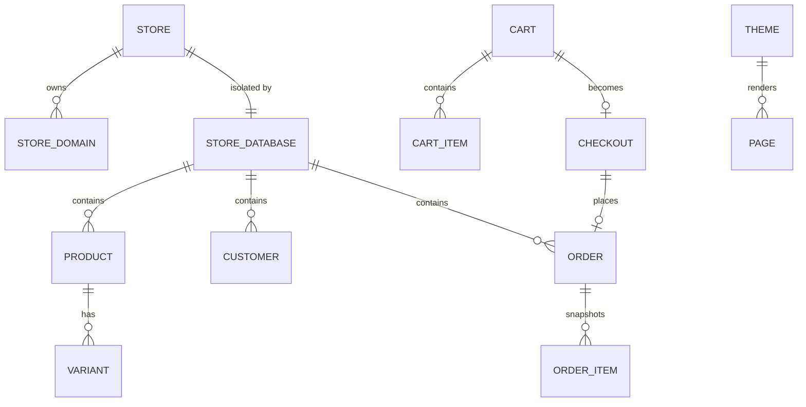

# Fastcart Constitution

## Product

Fastcart is a lightweight, self-hosted commerce platform for independent stores: a single Rust modular monolith, one SQLite database per store, a React admin and a framework-agnostic universal SSR storefront. It serves merchants who want Medusa-class domain capabilities without mandatory PostgreSQL, Redis or a message broker.

## Scope Boundaries

**In scope:**

- Store registry, domains, provisioning, lifecycle and multi-store isolation.
- Catalog, pricing, promotions, inventory, carts, checkout, orders, payments, fulfilment, returns and after-sales.
- Customers, addresses and store-scoped authentication.
- Storefront artifact registry, versioned activation/rollback, structured pages, previews and a process-isolated universal SSR storefront.
- Admin operations, public storefront APIs, provider registries, webhooks, outbox, jobs and workflows.
- Single-node operations: SQLite, backups, metrics, health checks, a `fastcart-serve` binary and a supervised `workerd` runtime.

**Explicitly out of scope:**

- Microservices, Kubernetes-only deployment, mandatory PostgreSQL/Redis and distributed event streaming.
- Marketplace/multi-vendor operation, subscriptions and enterprise multi-region replication.
- Arbitrary untrusted user code execution inside the host process. Theme bundles are trusted; plugin code is not executed by the host.
- Fully autonomous AI commerce operations and a public plugin marketplace.
- Full storefront i18n, production data import and a plugin contribution system in the first release; these are separately scoped.

**Phase boundaries:**

- Phase 1: the commerce core, multi-store isolation, the admin operating surface, a complete default-storefront purchase funnel, the Puck page editor and the universal `workerd` SSR runtime.
- Phase 2: storefront i18n, data import, plugin contributions and AI-assisted editing.

## Data Model / Schema Foundation

The platform database owns the store registry, domains, users, sessions, memberships, roles, API tokens and provisioning jobs. Every store owns a separate SQLite database containing its catalog, pricing, inventory, carts, checkouts, orders, payments, content, themes, webhooks, jobs and outbox. There are no cross-database joins: a request resolves a store first, then opens that store's database, and every cache key is store-scoped. Published page snapshots are stored separately from draft bodies so a published page remains stable while editing continues. Storefront artifacts live on the filesystem as trusted bundles; the database stores artifact manifests, deployment versions, settings and activation state.

## Non-negotiables

- Every storefront and admin request resolves exactly one store before any commerce access; an ID from another store is treated as not found. Verified by the cross-store isolation tests.
- Commerce rows exist only in the owning store's SQLite database; the platform database stores no catalog, cart, order or payment rows. Verified by the migration layout and isolation tests.
- Money is integer minor units. Totals, discounts, tax and shipping are calculated server-side; client-submitted totals are never trusted. Verified by cart, checkout and order tests.
- The production storefront serves only published records. Draft content requires a valid, signed, store-scoped preview token. Verified by storefront and preview tests.
- Storefront artifacts are trusted server-side code executed in a process-isolated `workerd` runtime with time, memory, concurrency and artifact-size limits. A `workerd` isolate is not an operating-system sandbox, and untrusted third-party code must not be loaded as a trusted artifact.
- Cookie-authenticated admin mutations require a CSRF token, and every handler enforces an RBAC permission before mutating data. Verified by auth and RBAC tests.
- A page body is validated against the active theme editor manifest before publication; an invalid page cannot be published. Verified by content and theme validation tests.
- Streaming responses carry a total deadline and byte cap; an aborted stream is never reported as a successful complete response. Verified by SSR gateway and runtime tests.
- Destructive store data removal requires a verified backup first. Verified by the platform deletion flow.
- A default deployment must run without Redis, PostgreSQL or a message broker; SQLite is the default and supported store.

## Amendment Log

Amendments are appended here as `## Amendment N — YYYY-MM-DD: summary`; the sections above are not edited once ratified.

## Amendment 1 — 2026-11-08: implementation status of Phase 1 deliverables

> Historical status note. Amendment 2 replaces this amendment's SSR decision:
> the universal `workerd` runtime supersedes the embedded V8/Node sidecar line.

This amendment records delivery status only; the scope sections above are unchanged.

- The embedded V8 SSR runtime and the Puck page editor are listed in Phase 1 but
  are not implemented as of this amendment. ADR 0002 and ADR 0004 remain Accepted
  decisions with `implementation: not-started`. The shipped implementations are
  the Node sidecar and the bespoke block editor.
- The theme-runtime non-negotiable says worker limits bound "CPU, heap and time".
  The Node worker implementation bounds heap and wall-clock time; it does not cap
  CPU. CPU isolation remains an operator concern (container limits or a separate
  sidecar per trust domain).
- The default theme does not yet implement the purchase funnel named in the v1
  PRD. That gap is tracked as product work, not claimed as complete here.

## Amendment 2 — 2026-11-09: universal SSR runtime replaces the Node/V8 adapter line

The SSR architecture is amended by [ADR 0007](adr/0007-universal-ssr-runtime-with-workerd.md)
and the [Universal SSR Runtime](architecture/universal-ssr-runtime.md) plan.

- FastCart will run framework-built storefront artifacts in a process-isolated
  `workerd` runtime managed by `fastcart-serve`. The runtime contract is a
  standard Fetch handler; framework integration happens at build time.
- `runtime-v8`, `runtime-node`, `apps/theme-sidecar` and the `v8`/`node`/`auto`
  runtime switch are legacy. They are not extended and are removed once the
  workerd path reaches parity. ADR 0002 and ADR 0005 are superseded.
- The Phase 1 embedded-V8 deliverable and the amendment-1 status statement are
  replaced by this decision. The legacy Node sidecar remains the only working
  implementation until the workerd phases land; that is transitional code, not
  the target architecture.
- A deployment is two processes, not a single binary: `fastcart-serve` plus the
  supervised `workerd` runtime when SSR is enabled. Docker is not a supported
  deployment path.
